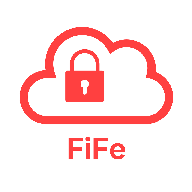

<div align="center">
  
  
  # FiFe - Your private Files Ferry
  
  **[https://fife.jeero.one](https://fife.jeero.one)**

  An open-source, cloud storage backup service built with zero-trust architecture. Your data is encrypted locally before it ever leaves your device.
  
  
  
  
  
</div>

<br/>

## 🛡️ Why FiFe?

Traditional cloud storage providers hold the keys to your data. FiFe shifts the control back to you. By combining **Bring Your Own Storage (BYOS)** with strict **Client-Side Encryption**, FiFe ensures that nobody—not even the server hosting the app—can read your files.

## ✨ Key Features

- **🔒 Zero-Knowledge Client-Side Encryption:** Files are encrypted entirely on your device using `libsodium` before uploading. The server only stores encrypted key ciphers and nonces.
- **☁️ Bring Your Own Storage:** Connect your own object storage buckets. Currently supports **Backblaze B2**, **Cloudflare R2**, **Oracle Object Storage**, **IDrive E2**, and generic **S3-compatible** providers.
- **📂 Preserves Folder Structure:** Back up entire directories without losing your organizational hierarchy.
- **⚡ Smart Duplicate Detection:** Computes hashes locally on-demand to detect duplicate files, saving your bandwidth and storage space.
- **🚀 Direct-to-Cloud Uploads:** Uploads bypass the backend completely, utilizing secure, pre-signed URLs directly to the storage provider.
- **🚫 Zero Tracking:** Built with strict privacy in mind. Absolutely no third-party analytics or data harvesting.

## 🏗️ Architecture & Tech Stack

FiFe is split into a robust cross-platform client and an edge-optimized server:

**Frontend / Client App**
- Built with **Flutter** for Android, iOS, OSX, and Linux (AppImages).
- Android synchronization uses a foreground service; iOS uses native `BGAppRefreshTask` callbacks with a bounded headless Flutter worker. Desktop synchronization uses a timer.
- Local metadata management via SQLite.

**Backend / API**
- Built with **SvelteKit** and deployed on **Cloudflare Workers**.
- Database: **Neon Postgres** using **Drizzle ORM**.
- Uses Cloudflare Hyperdrive for accelerated database connections.
- Authentication handled securely via Email OTP (Neon.tech).

## 🚀 Getting Started

### Prerequisites
- Flutter SDK (latest stable)
- Node.js & npm (for backend development)
- A Neon Postgres database URL
- Cloudflare Wrangler CLI

### Running the App Locally

1. **Clone the repository:**
   ```bash
   git clone https://github.com/jeerovan/secure_file_vault.git
   cd secure_file_vault
   ```

2. **Run the Flutter Client:**
   ```bash
   flutter pub get
   flutter run
   ```

3. **Backend Setup (SvelteKit):**
   Navigate to the server directory, install dependencies, and configure `DATABASE_URL` in `.env`. If it is omitted, database scripts use `postgres://jeerovan@localhost:5432/fife`.
   ```bash
   cd backend
   npm install
   npm run db:seed postgres # local PostgreSQL
   npm run db:seed neon     # production Neon
   npm run dev
   ```

   The driver argument is optional. Scripts infer Neon for `*.neon.tech` URLs and standard PostgreSQL for other URLs.

### Local integration testing

Local integration mode bypasses only Neon authentication and exercises the real local backend, PostgreSQL database, encryption, synchronization, and S3-compatible storage transfer paths.

1. Copy `backend/.env.example` to `backend/.env` and configure the `LOCAL_TEST_*` values. Use the same random token for the backend and Flutter build.
2. Ensure the database is initialized and provider ID 6 is registered:

   ```bash
   cd backend
   npm run db:add-s3 postgres
   npm run dev:local
   ```

3. Launch the client:

   ```bash
   flutter run \
     --dart-define=LOCAL_TESTING=true \
     --dart-define=LOCAL_TEST_AUTH_TOKEN=<RANDOM_LOCAL_TOKEN>
   ```

4. Sign in with `jeevan@jeero.one`. iOS Simulator connects through `localhost`; Android Emulator uses `10.0.2.2`.
5. Create the profile and register the device, then open **Storage**, select **S3 Compatible**, and enter the test storage credentials in the client. This exercises client-side validation and the normal `/api/s3/add-account` API. The S3 endpoint must be a public HTTPS URL in every mode, including local testing.

Local logout removes that device registration and clears its app-managed local data. The vault, recovery phrase, provider connections and cloud files remain available when signing in again.

### Running the local cleanup worker manually

The API development server does not run Cloudflare Cron. Keep a cleanup worker running in a second terminal to process retired uploads and confirmed vault resets. It uses the same cleanup cycle as production: one cycle immediately, then every five minutes, with at most two upload jobs and two reset targets per cycle. Slow cycles do not overlap; failed cycles retry on the next interval.

For the disposable provider-test server, leave the existing server running and start:

```bash
cd backend
npm run cleanup:local
```

The command attaches to the running `npm run dev:providers` server through its private `/tmp/fife_b2_s3_server.json` control file. It does not create, reseed or drop the database, and ignores `DATABASE_URL` and `.env`. Provider credentials come from that database. If the server stops or its control file changes, the worker stops at its next cycle; restart the worker after starting the replacement server. Keep the provider-test server running during manual testing: stopping that disposable server drops its test database.

If the provider-test server is not running, configure its local authentication and Backblaze inputs in `backend/.env`, then start it against a dedicated PostgreSQL test cluster on a non-default port. This creates a fresh disposable database:

```bash
# In backend/, with an existing dedicated test cluster on port 55432
FIFE_RECOVERY_TEST_DATABASE_URL='postgres://USER@127.0.0.1:55432/postgres' npm run dev:providers
```

For a regular `npm run dev:local` server, explicitly select the **same initialized local database** for both processes:

```bash
# Terminal 1, in backend/
FIFE_LOCAL_DATABASE_URL='postgres://USER@127.0.0.1:5432/fife' npm run dev:local

# Terminal 2, in backend/
FIFE_LOCAL_DATABASE_URL='postgres://USER@127.0.0.1:5432/fife' npm run cleanup:local
```

Only loopback PostgreSQL URLs are accepted. Admin/template databases and URL query parameters are rejected. For a single cycle, use `npm run cleanup:local -- --once`; a custom provider-server control file can be selected with `--control-file /path/to/server.json`. Stop the worker with **Ctrl+C**; it waits for an active cycle before closing its database connections.

Each successful cycle prints `Cleanup cycle completed; heartbeat updated.` and updates `recovery_worker_state` (`id = 'cleanup'`, `last_run_at` in Unix milliseconds). A failed cycle does not refresh the heartbeat. Vault reset still requires its normal server gates and a heartbeat less than 15 minutes old. To enable reset for the local test account, add the following to ignored `backend/.env.development.local`:

```dotenv
RECOVERY_RESET_ENABLED=true
RECOVERY_WORKER_READY=true
RECOVERY_RESET_EMAILS=jeevan@jeero.one
```

Vite reloads development environment changes. These flags only allow entry to the reset flow; deletion still requires explicit confirmation, and new-vault use waits for verified cloud deletion and the existing upload-expiry safety window. Keep production rollout settings in `wrangler.toml` unchanged.

### Building for iOS

`permission_handler` is used for Android storage permissions and iOS notifications. Camera and photo-library permission code must not be compiled into the iOS app unless the corresponding user-facing usage descriptions are intentionally added to `ios/Runner/Info.plist`.

Before the first iOS build after cloning, changing branches, changing `permission_handler.yaml`, or editing an iOS usage description, run:

```bash
flutter clean
flutter pub get
dart run permission_handler_apple:select app-store
```

Then build normally, for example:

```bash
flutter build ipa --release \
  --dart-define-from-file=.secrets/ios-hosted-defines.json \
  --dart-define=LOCAL_TESTING=false \
  --dart-define=FIFE_BACKGROUND_TEST_DIAGNOSTICS=false
```

The selection command clears stale Swift Package Manager/Xcode permission caches. The **Verify iOS Permissions** Runner build phase stops Xcode archives when the selection is missing, stale, or does not match the active build configuration. Do not bypass that build-phase failure; rerun the selection command instead.

The ignored defines file must contain the intended hosted `API_BASE_URL`, matching `NEON_AUTH`, and `RC_KEY_IOS`. Flutter does not automatically read `.env`; a hosted URL alone does not disable local authentication. Keep OAuth tokens, recovery phrases and signing credentials outside tracked files. The app's privacy manifest declares app-private `UserDefaults` and file metadata access within its container and explicitly selected folders; dependency manifests remain bundled with their SDKs.

For direct `xcodebuild test` runs, first prepare the generated iOS package with `flutter build ios --profile` using the same hosted defines. Flutter test/package tooling can regenerate its platform defaults; the Flutter iOS build reapplies the project's supported deployment target before Xcode resolves packages.

### iOS release candidate: 1.0.12 (23)

This candidate includes restored bookmark access, existing-root permission renewal, verified empty-file downloads, Explorer refresh after external edits, background engine cleanup before task completion, priority for queued background transfers, and sanitized error logging. Background sync remains an optional opt-in feature with a protective deadline and foreground recovery.

The full Flutter suite passes (134 tests, one expected platform skip), analysis is clean at all severities, and 21 native tests pass on the physical iPhone. Successful background upload is assigned to the user's production verification and is not claimed as passed. See [the physical test record and release checks](IOS-PHYSICAL-TEST-PLAN.md#production-release-preparation--2026-10-13) for artifact status, test scope and remaining limits.

## 🤝 Contributing

Contributions, issues, and feature requests are welcome! Feel free to check the [issues page](https://github.com/jeerovan/secure_file_vault/issues).

1. Fork the Project
2. Create your Feature Branch (`git checkout -b feature/AmazingFeature`)
3. Commit your Changes (`git commit -m 'Add some AmazingFeature'`)
4. Push to the Branch (`git push origin feature/AmazingFeature`)
5. Open a Pull Request

## 📄 License

This project is open-source and available under the [AGPL-3.0 License](LICENSE).
